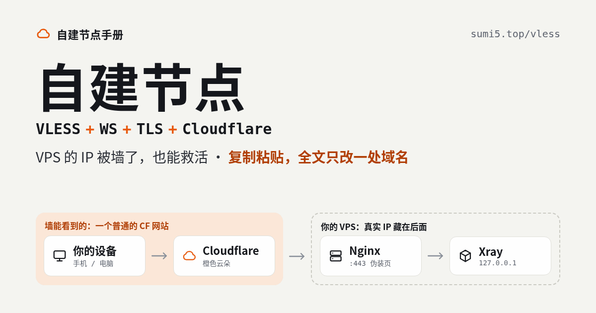
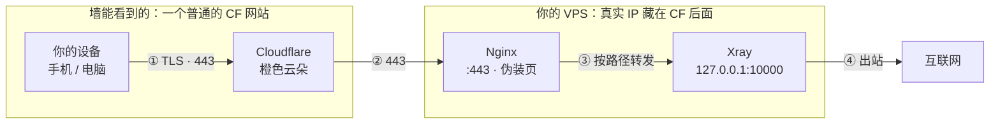

# 自建节点：VLESS + WS + TLS + Cloudflare



> 网页版排版更好、命令可一键复制：[https://sumi5.top/vless/](https://sumi5.top/vless/)

技术教程 · 2026 年 10 月 16 日更新 · 阅读约 9–12 分钟

客户端只连 Cloudflare，由 CF 把流量转给你的 VPS。墙只能看到你在访问一个普通的 CF 网站，看不到 VPS 的真实 IP——所以**VPS 的 IP 就算被墙了，也能用这套方法救活**。

- 需要：VPS · 域名 · 免费 CF 账号
- 不会 Linux 也行：按顺序复制粘贴
- 全文只改一处：你的域名

## 目录

1. [这套方案是什么](#这套方案是什么)
2. [准备工作](#准备工作)
3. [第一步：开放 80 / 443 端口](#第一步开放-80--443-端口)
4. [第二步：Cloudflare 后台设置](#第二步cloudflare-后台设置)
5. [第三步：VPS 基础环境与证书](#第三步vps-基础环境与证书)
6. [第四步：安装并配置 Xray](#第四步安装并配置-xray)
7. [第五步：配置 Nginx 反代与伪装页](#第五步配置-nginx-反代与伪装页)
8. [第六步：启动与验证](#第六步启动与验证)
9. [第七步：生成链接并导入客户端](#第七步生成链接并导入客户端)
10. [进阶（可选）](#进阶可选)
11. [常见问题排查](#常见问题排查)
12. [不要做的事与日常维护](#不要做的事与日常维护)

## 流量路线



## 这套方案是什么

客户端只和 CF 打交道。墙只能看到你在访问一个普通的 CF 网站，看不到 VPS 的真实 IP。

1. 你的设备 → CF（443 端口，TLS，SNI 是你的节点域名）
2. CF → VPS 上的 Nginx（443）
3. Nginx 按路径把流量交给本机的 Xray
4. Xray → 互联网

整条链路里只有 CF 直接面对你的设备，Nginx 和 Xray 都藏在它后面。

- **需要**：一台 VPS、一个自己的域名、一个免费的 CF 账号
- **代价**：多了一跳。速度主要看 CF 到你所在运营商的线路，晚高峰可能变慢，可以用文末的[「优选 IP」](#优选-cloudflare-ip)改善
- **门槛**：不会 Linux 也没关系：按顺序**复制粘贴命令**即可，需要你自己改的只有域名

> [!NOTE]
> **关于速度，先说实话**
>
> 套 CF 不一定比直连快，有时还更慢。如果你的 VPS 是中国优化线路，那么直连更快。

> [!WARNING]
> **先知道一件事：CF 的条款不允许这种用法**
>
> [Cloudflare 用户协议](https://www.cloudflare.com/terms/)第 2.2.1 条禁止用它的服务提供 VPN 或类似代理服务（j 项），也禁止把域名流量导向不是 CF 分配给这个域名的 IP（b 项，也就是文末的「优选 IP」）。截至 2026 年 10 月，公开讨论里还没看到普通 VPS 套橙云被处理的案例（用 Workers 搭的节点有过集中失效），但条款上属于违规，账号可能被停用。
>
> 所以**单独注册一个 CF 账号、单独买一个便宜域名专门搭节点**，别和重要网站放在一起。

## 准备工作

- **VPS**：系统选 **Debian 12** 或 **Ubuntu 22.04 / 24.04**
- **域名**：任何注册商都行，例如 Namesilo
- **Cloudflare 账号**：免费版就够
- **SSH 工具**：Windows 用 FinalShell；Mac / Linux 用自带终端；安卓手机可用 ConnectBot

### 把域名托管到 Cloudflare

1. 登录 CF → 添加站点（Add a domain）→ 输入域名 → 选 **Free** 计划
2. CF 会给你两条 NS（名称服务器）地址
3. 回到买域名的网站，把域名的 NS 改成 CF 给的这两条
4. 等 CF 后台显示 **Active**（几分钟到 24 小时不等）

### 登录 VPS

大多数厂商给的是 root 密码：

<sub>你的电脑 · 终端</sub>

```bash
ssh root@你的VPS的IP
```

有的厂商（如甲骨文、AWS）不给 root 密码，而是用建机时下载的**私钥文件** + 默认用户名（Ubuntu 镜像一般是 `ubuntu`）：

<sub>你的电脑 · 终端</sub>

```bash
ssh -i 私钥文件路径 ubuntu@你的VPS的IP
sudo -i
```

- 第一次连接会问 yes/no，输入 `yes` 回车
- 用私钥登录的，<strong>先执行 `sudo -i`</strong> 切到 root。下文所有命令都在 root 下执行
- 粘贴命令：终端里一般是**右键**或 <kbd>Ctrl</kbd>+<kbd>Shift</kbd>+<kbd>V</kbd>，不是 <kbd>Ctrl</kbd>+<kbd>V</kbd>
- VPS 的 IP 已经被墙、SSH 连不上：先开着别的代理再连

## 第一步：开放 80 / 443 端口

端口没开，后面全白做，CF 会报 522。要检查两个地方。

### 检查 1：厂商网页后台的防火墙 / 安全组

很多厂商默认全开，不用管。有「安全组」「防火墙规则」这类设置的，添加入站规则：TCP，端口 `80` 和 `443`，来源 `0.0.0.0/0`。

### 检查 2：系统里的防火墙

大多数 VPS 的系统里默认没有防火墙，不用管。执行 `ufw status`：

- 显示 `inactive` 或提示找不到命令 → **跳过**
- 显示 `active` → **执行下面两行**

<sub>VPS 终端</sub>

```bash
ufw allow 80/tcp
ufw allow 443/tcp
```

### 甲骨文（Oracle Cloud）：两道防火墙都要开

> [!WARNING]
> 甲骨文有**两层防火墙**，漏掉任何一层都会连不上，这是甲骨文上最常见的坑。

#### 第 1 道：网页后台的安全列表

`实例详情 → 点「子网」→ 安全列表（Security Lists）→ 默认安全列表 → 添加入站规则`

- **源 CIDR**：`0.0.0.0/0`
- **IP 协议**：TCP
- **目标端口范围**：`80,443`

#### 第 2 道：系统里的 iptables

甲骨文的 Ubuntu 镜像自带一套 iptables 规则，默认只放行 22 端口。执行：

<sub>VPS 终端</sub>

```bash
iptables -I INPUT -p tcp -m multiport --dports 80,443 -j ACCEPT
netfilter-persistent save
```

> [!WARNING]
> **在甲骨文上不要用 ufw**
>
> 开端口只用上面这两行命令。甲骨文自己用 iptables 管防火墙，再开 ufw 两套会打架，SSH 可能直接连不上，只能去网页后台的控制台救（甲骨文社区有这类记录）。照着网上别的教程敲 `ufw enable` 就会碰到。

- 建实例时把镜像从默认的 Oracle Linux 换成 Ubuntu，ARM 和 AMD 都行
- 刚开机时 `apt` 可能提示被占用（系统在自动更新），等几分钟再继续

## 第二步：Cloudflare 后台设置

在 CF 后台改 4 个地方，最后拿到一张 15 年有效、不用续签的源站证书。CF 界面偶尔改版，按名字找即可。

1. **添加解析**： `DNS → Records → Add record`

   - **Type**：`A`
   - **Name**：`node`（节点域名就是 `node.你的域名`，下文用 `node.example.com` 举例）
   - **IPv4 address**：你的 VPS IP
   - **Proxy status**：<strong>橙色云朵打开（Proxied）</strong>，这是整套方案的核心
2. **SSL 模式**： `SSL/TLS → Overview` → 选 <strong>Full (strict)（完全（严格））</strong>
3. **WebSockets**： `Network` → 确认 WebSockets 是**开启**状态（默认就是开的）
4. **生成源站证书**： `SSL/TLS → Origin Server → Create Certificate`

   - 选项保持默认（RSA，包含 `*.你的域名` 和 `你的域名`，有效期 15 年）→ Create
   - 页面上会出现两段文本：**Origin Certificate**（证书）和 **Private Key**（私钥）

   > [!WARNING]
   > 两段都复制到电脑记事本里保存好。**私钥只显示这一次**，关掉页面就看不到了。

> [!TIP]
> **验证解析**
>
> 浏览器打开 `https://dns.google/resolve?name=node.example.com&type=A`（换成你的域名）。返回 `104.` 或 `172.` 开头的 IP 就对了；返回的是 VPS 自己的 IP，说明橙云没开。

> [!NOTE]
> **为什么用 CF 源站证书，而不是 Let's Encrypt**
>
> - 有效期 15 年，不用续签
> - 不需要从外网验证服务器，VPS 的 IP 被墙了也能装
> - 不用创建 API 令牌，少一个泄露点
>
> 它只在 CF 和 VPS 之间使用，客户端看到的仍然是 CF 的正规证书。代价见[「常见问题」最后一条](#想保留灰云直连退路就改用-acmesh)。

## 第三步：VPS 基础环境与证书

### 安装软件

<sub>VPS 终端</sub>

```bash
apt update && apt install -y curl nginx openssl nano
rm -f /etc/nginx/sites-enabled/default
```

第二行删掉 Nginx 自带的默认站点，避免和我们的配置冲突。

### 放入证书

<sub>VPS 终端</sub>

```bash
mkdir -p /etc/ssl/cf
nano /etc/ssl/cf/origin.pem
```

会打开一个编辑器。把记事本里的 **Origin Certificate** 整段粘贴进去（从 `-----BEGIN CERTIFICATE-----` 到 `-----END CERTIFICATE-----`），然后保存退出：<kbd>Ctrl</kbd>+<kbd>O</kbd> → <kbd>回车</kbd> → <kbd>Ctrl</kbd>+<kbd>X</kbd>。

用同样的方法放私钥：

<sub>VPS 终端</sub>

```bash
nano /etc/ssl/cf/origin.key
```

粘贴 **Private Key** 整段，同样 <kbd>Ctrl</kbd>+<kbd>O</kbd> → <kbd>回车</kbd> → <kbd>Ctrl</kbd>+<kbd>X</kbd>。然后执行：

<sub>VPS 终端</sub>

```bash
chmod 600 /etc/ssl/cf/origin.key
openssl x509 -in /etc/ssl/cf/origin.pem -noout -subject -enddate
```

> [!TIP]
> **做对的标志**
>
> 第二条能打印出 CloudFlare 字样和一个十几年后的日期，就说明证书放对了。报错的话，重新打开文件，检查有没有粘贴完整。

### 开启 BBR（建议）

<sub>VPS 终端</sub>

```bash
echo "net.core.default_qdisc=fq" >> /etc/sysctl.conf
echo "net.ipv4.tcp_congestion_control=bbr" >> /etc/sysctl.conf
sysctl -p
```

## 第四步：安装并配置 Xray

### 安装

<sub>VPS 终端</sub>

```bash
bash -c "$(curl -L https://github.com/XTLS/Xray-install/raw/main/install-release.sh)" @ install
```

### 设置变量（全文唯一需要你改的地方）

把第一行的 `node.example.com`（下面橙色框住的部分）换成你在第二步设置的节点域名，然后整段粘贴：

<sub>VPS 终端 · 先改第一行，再粘贴</sub>

```bash
DOMAIN=node.example.com
UUID=$(xray uuid)
WSPATH=/api/v3/$(openssl rand -hex 8)
cat > /root/node-info.txt <<EOF
DOMAIN=$DOMAIN
UUID=$UUID
WSPATH=$WSPATH
EOF
cat /root/node-info.txt
```

屏幕上会显示你的域名、UUID 和路径，它们已经保存在 `/root/node-info.txt`。

> [!NOTE]
> <strong>中途 SSH 断开重连了？</strong>
>
> 先执行 `sudo -i`（root 登录的跳过），再执行 `source /root/node-info.txt` 把变量找回来，然后继续。

### 生成 Xray 配置

<sub>VPS 终端</sub>

```bash
cat > /usr/local/etc/xray/config.json <<EOF
{
  "log": { "loglevel": "warning" },
  "inbounds": [
    {
      "listen": "127.0.0.1",
      "port": 10000,
      "protocol": "vless",
      "settings": {
        "clients": [ { "id": "$UUID" } ],
        "decryption": "none"
      },
      "streamSettings": {
        "network": "ws",
        "wsSettings": { "path": "$WSPATH" }
      }
    }
  ],
  "outbounds": [ { "protocol": "freedom" } ]
}
EOF
xray run -test -config /usr/local/etc/xray/config.json
```

> [!TIP]
> **做对的标志**
>
> 最后一行输出 `Configuration OK`。

#### 配置里的几处要点

- <strong>`listen: 127.0.0.1`</strong>：Xray 只在本机监听，外网扫描不到，所有流量必须经过 Nginx
- <strong>`decryption: none`</strong>：保持这样，**不要**开启 VLESS Encryption（vlessenc）。它本身能过 CDN，但两端必须配得一模一样，而且不少客户端还不支持，新手开了容易连不上
- <strong>不要加 `flow`</strong>：**不要**加 `flow: xtls-rprx-vision`，Vision 流控不能跑在普通 WebSocket 上
- <strong>「WS 已弃用」提示</strong>：新版 Xray 可能提示 WebSocket 已弃用、建议改 XHTTP：只是警告，目前照样能用。WS 的好处是所有客户端都支持

## 第五步：配置 Nginx 反代与伪装页

Nginx 对外监听 443：普通访问看到的是一个普通网页，只有带正确路径的 WebSocket 请求才会转给 Xray。

### 伪装页

<sub>VPS 终端</sub>

```bash
echo '<!doctype html><title>Welcome</title><h1>Welcome</h1><p>Site under construction.</p>' > /var/www/html/index.html
```

想更像真网站，可以换成任何静态网页模板，放进 `/var/www/html/`。

### 生成 Nginx 配置

<sub>VPS 终端</sub>

```bash
cat > /etc/nginx/conf.d/xray.conf <<EOF
server {
    listen 80;
    server_name $DOMAIN;
    return 301 https://\$host\$request_uri;
}

server {
    listen 443 ssl;
    server_name $DOMAIN;

    ssl_certificate     /etc/ssl/cf/origin.pem;
    ssl_certificate_key /etc/ssl/cf/origin.key;
    ssl_protocols TLSv1.2 TLSv1.3;

    root /var/www/html;
    index index.html;

    location $WSPATH {
        if (\$http_upgrade != "websocket") { return 404; }
        proxy_pass http://127.0.0.1:10000;
        proxy_http_version 1.1;
        proxy_set_header Upgrade \$http_upgrade;
        proxy_set_header Connection "upgrade";
        proxy_set_header Host \$host;
        proxy_read_timeout 300s;
    }
}
EOF
nginx -t
```

> [!TIP]
> **做对的标志**
>
> 输出 `syntax is ok` 和 `test is successful`。

- 命令里的 `\$` 是故意的，不要删，否则 Nginx 变量会被 shell 吃掉
- `nginx -t` 如果报某条指令 `is duplicate`，说明同一条指令写了两次，删掉其中一行即可

### 加固：直接用 IP 访问时拒绝握手

现在有人直接访问 `https://你的VPS的IP`，Nginx 会亮出带你域名的证书。网络扫描站会把这些记下来，等于公开了「这个 IP 就是这个域名的源站」，CF 帮你藏的 IP 就白藏了。

加一个兜底站点：没带对域名的连接，一律拒绝握手。

<sub>VPS 终端</sub>

```bash
cat > /etc/nginx/conf.d/00-default.conf <<EOF
server {
    listen 443 ssl default_server;
    ssl_reject_handshake on;
}
EOF
nginx -t
```

看 `nginx -t` 的输出：

- 显示 `test is successful` → **完成**
- 报 `unknown directive "ssl_reject_handshake"` → **Nginx 版本太老（Ubuntu 22.04 自带的就是），执行下面这段代替**

<sub>VPS 终端 · 仅 Nginx 太老时</sub>

```bash
openssl req -x509 -nodes -newkey rsa:2048 -days 3650 -subj "/CN=localhost" \
  -keyout /etc/ssl/cf/default.key -out /etc/ssl/cf/default.pem
cat > /etc/nginx/conf.d/00-default.conf <<EOF
server {
    listen 443 ssl default_server;
    ssl_certificate     /etc/ssl/cf/default.pem;
    ssl_certificate_key /etc/ssl/cf/default.key;
    return 444;
}
EOF
nginx -t
```

这段给兜底站点配一张写着 localhost 的假证书，连接进来后直接断开，同样看不到你的域名。

> [!NOTE]
> **它能挡什么、挡不了什么**
>
> 挡的是「扫 IP 看证书」。挡不住「拿着你的域名挨个 IP 去试」，要连这个也挡，做进阶里的[「源站只放行 CF 的 IP」](#源站只放行-cf-的-ip)。

> [!NOTE]
> **443 被挡怎么办**
>
> 把 `listen 443 ssl;` 改成 `listen 8443 ssl;`（兜底站点 `00-default.conf` 里的 443 也一起改），第一步的防火墙也放行 8443，客户端端口也改成 8443。
>
> CF 支持的 HTTPS 端口：`443` `2053` `2083` `2087` `2096` `8443`

## 第六步：启动与验证

<sub>VPS 终端</sub>

```bash
systemctl enable --now xray nginx
systemctl restart xray nginx
systemctl status xray nginx --no-pager
```

> [!TIP]
> **做对的标志**
>
> 两个服务都显示绿色的 `active (running)`。

### 测试 1：伪装页能打开

<sub>VPS 终端</sub>

```bash
curl -sI https://$DOMAIN | head -n 5
```

> [!TIP]
> **做对的标志**
>
> 看到 `200` 和 `server: cloudflare`。也可以直接用浏览器打开 `https://你的节点域名`，能看到 Welcome 页面。

### 测试 2：WebSocket 能通到 Xray

<sub>VPS 终端</sub>

```bash
curl -s -i --http1.1 --max-time 5 \
  -H "Connection: Upgrade" -H "Upgrade: websocket" \
  -H "Sec-WebSocket-Version: 13" -H "Sec-WebSocket-Key: SGVsbG8sIHdvcmxkIQ==" \
  https://$DOMAIN$WSPATH | head -n 1
```

> [!TIP]
> **做对的标志**
>
> 看到 `101 Switching Protocols`，就说明 CF → Nginx → Xray 整条链路全通，可以去配客户端了。

### 测试 3：直接访问 IP 被拒绝

<sub>VPS 终端</sub>

```bash
curl -sk -o /dev/null -w '%{http_code}\n' https://127.0.0.1
curl -sk -o /dev/null -w '%{http_code}\n' --resolve $DOMAIN:443:127.0.0.1 https://$DOMAIN
```

> [!TIP]
> **做对的标志**
>
> 第一行输出 `000`（不带域名，握手被拒，什么都没拿到），第二行输出 `200`（带对域名，照常打开伪装页）。第一行如果也是 `200`，说明兜底站点没生效，回[第五步的加固](#加固直接用-ip-访问时拒绝握手)检查。

### 出问题时看日志

<sub>VPS 终端</sub>

```bash
journalctl -u xray -n 50 --no-pager
tail -n 50 /var/log/nginx/error.log
```

错误码对照见[「常见问题排查」](#常见问题排查)。

## 第七步：生成链接并导入客户端

在 VPS 上一条命令生成节点链接：

<sub>VPS 终端</sub>

```bash
source /root/node-info.txt
echo "vless://${UUID}@${DOMAIN}:443?encryption=none&security=tls&sni=${DOMAIN}&fp=chrome&type=ws&host=${DOMAIN}&path=$(echo "$WSPATH" | sed 's#/#%2F#g')#CF-WS"
```

输出的那一整行 `vless://...` 就是节点链接，复制到客户端里「从剪贴板导入」即可。用 8443 的话，把链接里的 `:443` 改成 `:8443`。

- **Windows**：v2rayN、Clash Verge Rev（复制链接 → 从剪贴板导入）
- **macOS**：Clash Verge Rev、v2rayN（复制链接 → 从剪贴板导入）
- **Android**：v2rayNG、FlClash（右上角 + → 从剪贴板导入）
- **iOS**：Shadowrocket、Stash（需外区 Apple ID）（复制链接后打开 App 会自动识别）

### 手动填写对照表

- **地址**：你的节点域名
- **端口**：443
- **UUID**：node-info.txt 里的 UUID
- **加密**：none
- **流控 Flow**：**留空**（WS 不能用 vision）
- **传输**：ws
- **WS 路径**：node-info.txt 里的 WSPATH（和服务端一字不差）
- **WS Host**：你的节点域名
- **TLS**：开
- **SNI**：你的节点域名
- **指纹**：chrome

### Clash / Mihomo 配置写法

<sub>Clash / Mihomo · YAML</sub>

```yaml
- name: CF-WS
  type: vless
  server: node.example.com
  port: 443
  uuid: 你的UUID
  udp: true
  tls: true
  servername: node.example.com
  client-fingerprint: chrome
  network: ws
  ws-opts:
    path: /api/v3/你的路径
    headers:
      Host: node.example.com
```

> [!WARNING]
> **规则**
>
> `server`（地址）以后可以换成优选 IP，但 `servername`（SNI）和 `Host` **永远填你的域名**，不能填 IP。

## 进阶（可选）

### 优选 Cloudflare IP

节点能用但嫌慢，或者出现「ping 得通、连不上」（有的地区、时段运营商会掐 CF 的部分 IP），可以用 CloudflareSpeedTest 从 CF 的众多 IP 里挑出你本地连得最快的那个，填进客户端的「地址」。

1. 在 GitHub 搜 `XIU2/CloudflareSpeedTest`，下载对应系统的版本（新版程序名是 `cfst`，旧版叫 `CloudflareST`）
2. 在**你自己的电脑上**运行（不是 VPS 上），因为要测的是你本地到 CF 的速度
3. 把结果 `result.csv` 里排第一的 IP 填进客户端的「地址」，SNI 和 Host 保持域名不变

> [!WARNING]
> **测速前必须关掉所有代理 / VPN**，否则测出来的是代理线路的速度。

<sub>你的电脑 · 终端</sub>

```bash
# 节点用 443 端口
./cfst -tp 443 -dn 10

# 节点用 8443 端口
./cfst -tp 8443 -dn 10
```

- 用 8443 时不要加 `-f` 导入网上收集的反代 IP 列表，那些 IP 基本只开 443
- 想看下载速度就不要加 `-httping`，加了测不出下载速度
- 优选 IP 会随时间变化，变慢了就重新测一次
- 晚上某个网段突然大面积超时，换一个不同网段的 IP 再测
- 优选 IP 正是 CF 条款禁止的用法（见[开头的说明](#这套方案是什么)），这也是建议节点单独用一个 CF 账号的原因

### 源站只放行 CF 的 IP

第一步里 443 对所有人开放。改成只放行 CF 的 IP 段后，别人直接扫你 VPS 的 IP，什么都看不到。

- 在厂商后台的安全组（甲骨文是安全列表）里，把 443 规则的来源从 `0.0.0.0/0` 换成 CF 的 IPv4 段，一段一条规则
- CF 的 IP 段列表：`https://www.cloudflare.com/ips-v4`
- 22 端口（SSH）的规则别动
- 做了这一步，下面「常见问题」里的灰云直连退路也会失效，需要时得先把规则改回来
- 本文的 Nginx 只监听 IPv4，所以只放 IPv4 段就够。如果你自己给 Nginx 加了 IPv6 监听（`listen [::]:443`），CF 的 IPv6 段 `https://www.cloudflare.com/ips-v6` 也要加上，否则 IPv6 这条路没被拦住
- CF 的 IP 段很少变动，但以官网列表为准，隔几个月核对一次

## 常见问题排查

浏览器打开节点域名时，CF 给出的错误码基本就能定位问题在哪一段。

| 现象 | 原因 | 处理 |
| --- | --- | --- |
| **522** Connection timed out | CF 连不到 VPS。九成是第一步的端口没开（甲骨文是两道防火墙漏了一道） | 回[第一步](#第一步开放-80--443-端口)逐项核对；再用[下面的 tcpdump 方法](#522-排查流量到底有没有进来) |
| **521** Web server is down | Nginx 没在运行 | `systemctl status nginx`，按报错修好后 `systemctl restart nginx` |
| **525** SSL handshake failed | Nginx 证书没配好，或没监听 `443 ssl` | `nginx -t`；检查第三步的证书文件是否完整 |
| **526** Invalid SSL certificate | 源站证书不对 | 确认用的是 CF Origin 证书，且节点域名在证书范围内 |
| **502** Bad Gateway | Xray 没运行，或端口对不上 | `systemctl status xray`；确认两边都是 10000 |
| **403** Forbidden | SNI 或 Host 写的不是节点域名本身 | 对照[第七步](#手动填写对照表)重新填 |
| **404** 直接打开 WS 路径（正常） | 浏览器不带 WebSocket 升级头，被 Nginx 挡掉了 | 不用处理 |
| **网页正常、客户端连不上** | UUID / 路径填错；SNI 或 Host 填成了 IP；开了 vision 流控 | 重新生成[第七步](#第七步生成链接并导入客户端)的链接导入 |
| **能连上但很慢** | CF 线路晚高峰拥堵，或运营商限速 CF | 做[「优选 IP」](#优选-cloudflare-ip) |
| **ping 得通 CF 的 IP，但一直超时** | 运营商在掐 CF | 先优选 IP、换端口；还不行，见[灰云直连退路](#想保留灰云直连退路就改用-acmesh) |
| **域名解析出来不是 CF 的 IP** | 域名被 DNS 污染，解析到一个墙内打不开的 IP | 客户端「地址」直接填一个 CF 的 IP（见[「优选 IP」](#优选-cloudflare-ip)），SNI 和 Host 保持域名 |

### 522 排查：流量到底有没有进来

<sub>VPS 终端</sub>

```bash
tcpdump -ni any tcp port 443
```

运行后用浏览器访问几次节点域名：

- **一个包都没有** → **流量没到机器，是防火墙或上游挡了。回第一步检查；都对的话换 8443 试试，还不行就是 CF 到该机房的线路问题，只能换机器**
- **有包进来** → **网络是通的，回头检查 Nginx 和证书配置**

按 <kbd>Ctrl</kbd>+<kbd>C</kbd> 停止。没有 tcpdump 就先 `apt install -y tcpdump`。

### 想保留灰云直连退路，就改用 acme.sh

源站证书只有 CF 认。遇到运营商掐 CF、优选 IP 也救不回来时，可以把 CF 里的橙云临时关成灰云，让客户端直连 VPS。但用的是源站证书的话，客户端会因为证书不受信任而连不上。换成 Let's Encrypt 证书，橙云、灰云都能用。

先在 CF：`我的个人资料 → API 令牌 → 创建令牌`，权限选 `Zone:DNS:Edit`，作用域只选这个域名。然后在 VPS 上：

<sub>VPS 终端</sub>

```bash
source /root/node-info.txt
curl https://get.acme.sh | sh -s email=you@example.com
source ~/.bashrc
~/.acme.sh/acme.sh --set-default-ca --server letsencrypt
export CF_Token="你的令牌"
~/.acme.sh/acme.sh --issue --dns dns_cf -d $DOMAIN --keylength ec-256
~/.acme.sh/acme.sh --install-cert -d $DOMAIN --ecc \
  --fullchain-file /etc/ssl/cf/origin.pem \
  --key-file /etc/ssl/cf/origin.key \
  --reloadcmd "systemctl reload nginx"
```

> [!WARNING]
> <strong>令牌不要发给任何人，也不要贴进聊天。</strong>

- 证书直接覆盖原来的两个文件，Nginx 配置不用改。证书 90 天有效，acme.sh 会自动续期
- 灰云时 VPS 的 IP 直接暴露，只当临时退路。VPS 的 IP 已经被墙的话，灰云也没用

## 不要做的事与日常维护

### 不要做

- 不要把 CF 的 SSL 模式设成 <strong>Flexible（灵活）</strong>：CF 到 VPS 这一段会变成明文
- 不要开 VLESS Encryption，也不要加 vision 流控（理由见[第四步](#生成-xray-配置)）
- 不要把 Xray 改成监听 `0.0.0.0`：外网会直接扫到它
- 不要把节点链接、域名、服务器 IP 晒到群里或网上。要给家人朋友用，就在 `clients` 里再加一个 `{ "id": "另一个UUID" }`（用 `xray uuid` 生成），每人一个。如果发截图，一定要打码自己的 VPS IP
- WS 路径别用 `/ws`、`/v2ray`、`/vless` 这种烂大街的（本文脚本已自动生成随机路径）
- 不要拿放着重要网站的 CF 账号和域名搭节点：CF 条款不允许代理用途（见[开头的说明](#这套方案是什么)），账号被停用会连累同账号下的其他网站。单独注册一个账号、买一个便宜域名专门用

### 日常维护

- **更新 Xray**：重新运行[第四步的安装命令](#安装)，再 `systemctl restart xray`
- **更新系统**：`apt update && apt upgrade -y`
- **改完配置后重启**：`systemctl restart xray nginx`
- **忘了 UUID / 路径**：`cat /root/node-info.txt`

> [!NOTE]
> `/root/node-info.txt` 里存着节点的全部信息，建议另外在自己电脑上保存一份。

---

网页版：[https://sumi5.top/vless/](https://sumi5.top/vless/)，与本 README 由同一份源文件生成，内容一致。
